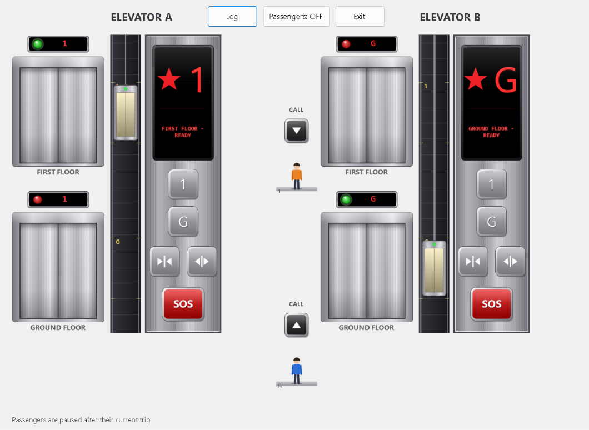
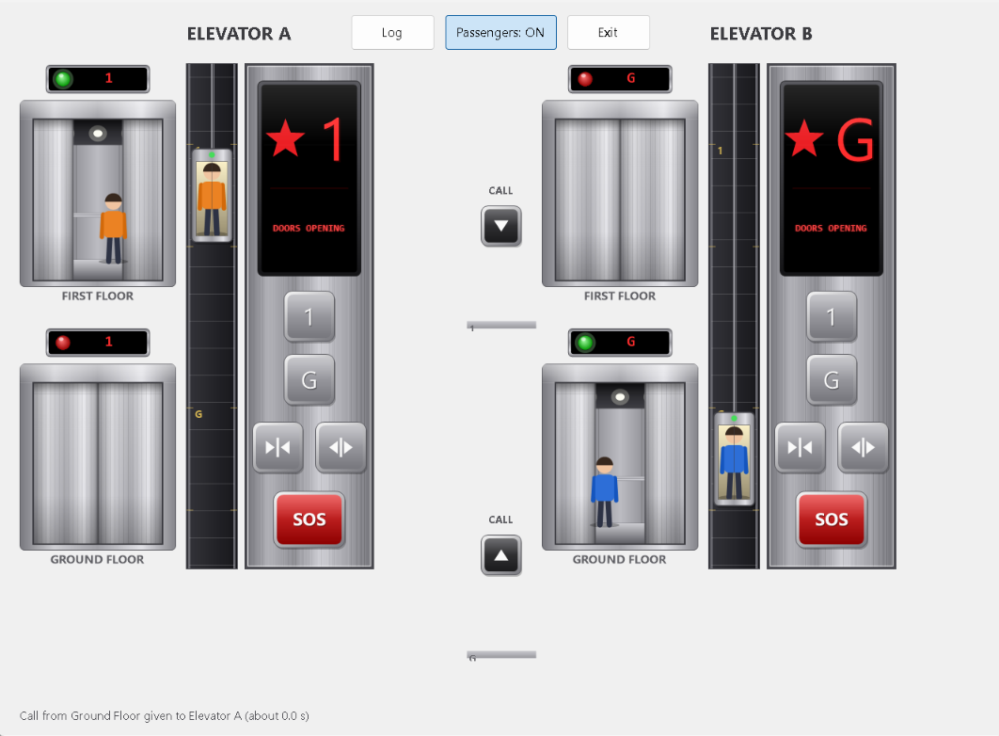
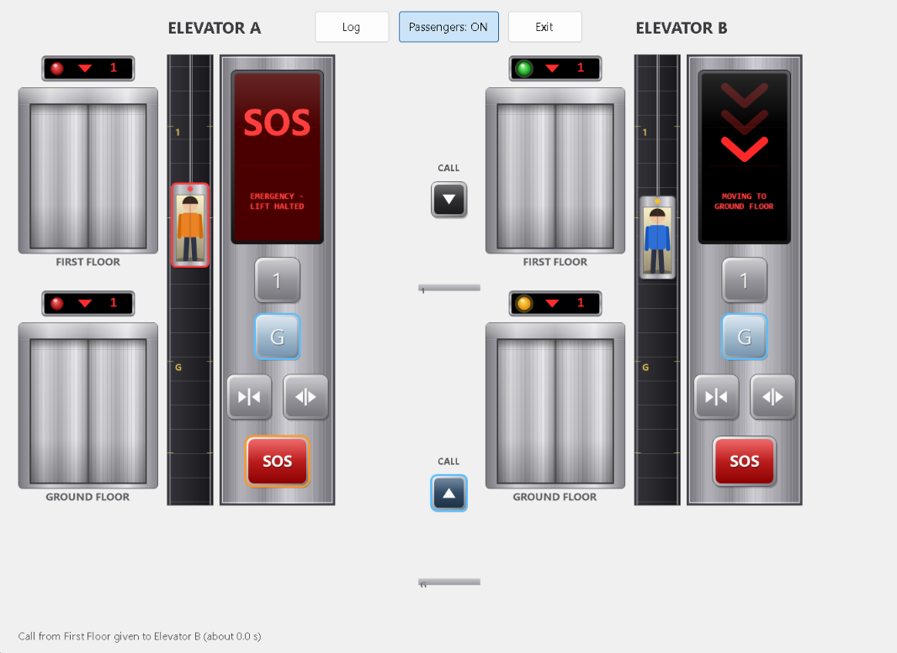
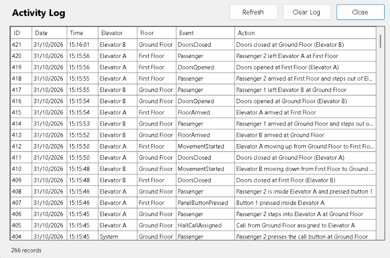

# 🛗 Lift: Two-Elevator Control System

**C# (.NET) Windows Forms · State and Observer patterns · SQL Server**

A desktop simulation of a building with **two floors (Ground and First) and two lifts side by side**.
Every lift has its own door on each floor, a moving car in its own shaft, its own control panel and its own emergency button.
Requests from outside are shared out by a dispatcher. Every operation is stored in a SQL Server database and can be shown in a log window.



*Main window: two lifts side by side. Each has its own doors on the First and Ground floor, a floor status display and lamp above every door, a shaft with a moving car, and its own control panel. The two call buttons between the lifts are the requests from outside.*

> University assignment (C#), Tasks 1 to 6. The table [Where each task is solved](#where-each-task-is-solved) shows the exact files.

---

## 📸 Screenshots

### A passenger using the lift


A passenger has pressed the call button, stepped in and pressed a floor button. The car (the container) slides through its shaft with the passenger inside, and the LED display shows the moving arrows and `MOVING TO ...`.

### The passenger reaches the dedicated floor



The car has arrived. The lamp above the door is green, the doors open, the display shows the new floor, and the passenger steps out. The arrival is saved in the log.

### The passenger clicks the emergency button



SOS stops that lift in the same instant. The car stays where it is between the floors with the passenger inside, its outline and lamp turn red, the siren sounds and the LED shows `EMERGENCY - LIFT HALTED`. The other lift keeps working. Press SOS again to continue the trip.

### The activity log (database)



Every operation is stored in SQL Server and shown here with ID, Date, Time, Elevator, Floor, Event and Action. The window has **Refresh**, **Clear Log** and **Close**, and new entries appear by themselves.

---

## Run it (nothing to install except Visual Studio)

1. Clone or download this repository, then open **`Lift.sln`** in Visual Studio 2022 or newer (workload ".NET desktop development").
2. Press **F5**.

That is all. On the first start the program **finds SQL Server by itself, creates the `ElevatorDb` database and all tables, and starts logging**. It tries these servers in order and uses the first one that answers:

| Order | Server | Where it comes from |
|---|---|---|
| 1 | `(localdb)\MSSQLLocalDB` | installed with Visual Studio |
| 2 | `.\SQLEXPRESS` | SQL Server Express |
| 3 | `localhost` | a full SQL Server on this computer |

To use another server, set the environment variable `LIFT_DB_SERVER` (for example `MYPC\SQL2022`) and start again.
The creation script is `Elevator_System/Database/Elevator.sql`. It is found with a **relative path** (`<program folder>\Database\Elevator.sql`), so the project works from any folder. You can also run it yourself in SSMS; it is safe to run many times.

If no server can be reached the lifts still run, a message explains what was tried, and nothing is logged.

## What you see

| Part | What it does |
|---|---|
| **Door + floor status display** (4 doors) | Metal doors that slide open and closed. The screen above each door shows where *that* lift is; the lamp is **green** (lift here), **amber blinking** (lift arriving) or **red** (lift elsewhere). |
| **Shaft with the moving car** | A metal car (the "container") hangs on a cable and slides between the floors. It is drawn exactly where the lift is, so it **stops in the same instant** the lift stops. |
| **Control panel** (one per lift) | LED display window (current floor, arrows while moving, status text), floor buttons `1` and `G`, door open and close buttons, red **SOS** button. Buttons light up while a request is waiting. |
| **Call buttons** (between the lifts) | One button per floor for requests from outside. The dispatcher picks the lift. |
| **Passengers** | Two people use the lifts all the time: one goes **G to 1 and back**, the other **1 to G and back**. They press the call button, step in, press the floor button, ride, and step out. The **Passengers: ON/OFF** button pauses them so you can test by hand. |
| **Log** button | Opens the log window: ID, Date, Time, Elevator, Floor, Event, Action. **Refresh**, **Clear Log**, **Close**. |
| **SOS** | Stops that lift at once (the car stops between the floors, the siren sounds, requests are refused). Press SOS again to continue. Doors can still be opened when the lift stands at a floor. |
| **Door sensor** | Leave the mouse pointer in a doorway while the doors close and they open again (like a real sensor). |

Sounds are generated in code (moving hum, arrival ding, siren). No sound files are needed.

## Where each task is solved

| Task | Marks | Where |
|---|---|---|
| 1 GUI | 20 | `UI/MainForm`, `UI/ElevatorUnitView`, `UI/LogForm`, `UI/Controls/*` |
| 2 Control logic | 10 | `Subject/Elevator`, `State/*`, `Controller/ElevatorDispatcher` |
| 3 Logging and data | 30 | `Database/Elevator.sql`, `Data/*` (see below) |
| 4 Animation, delegates + timer | 10 | `Controller/SimulationClock` (Timer), delegates `Tick`, `Stepped`, `Action<>` events |
| 5.1 BackgroundWorker | 5 | `Data/BackgroundLogWriter`, `Data/DbBackgroundRunner` |
| 5.2 Two lifts, State + Observer | 15 | `State/*`, `Observer/*`, `Subject/*`, `Controller/ElevatorDispatcher` |
| 6 Testing | 10 | `Lift.Tests` (74 automated checks) and the test report |

### Task 3 in detail
* **Database design:** `Floors`, `Elevators`, `ElevatorLog` with primary keys, foreign keys and a default timestamp (`Database/Elevator.sql`).
* **Disconnected model:** `SqlElevatorLogRepository` fills a `DataTable` with `DataAdapter.Fill()`, changes it in memory, and saves with `DataAdapter.Update()` (a `SqlCommandBuilder` creates the INSERT and DELETE commands). The only `ExecuteNonQuery()` calls are in `DatabaseInitializer`, because creating a database and tables is DDL, which an adapter cannot do.
* **Relative paths:** the script path is built from `AppContext.BaseDirectory` and the file is copied next to the program by `Lift.csproj`.
* **No duplicated database code:** saving and clearing both go through the single method `ModifyLog`; the log window runs every job through `RunDatabaseJob`; both call buttons use `CallFromHall`.
* **Exceptions:** every database call is wrapped; errors become a `DataAccessException` with a readable message, which the windows show without crashing.

## Design patterns

* **State pattern** (`State/`): `IdleState`, `MovingState`, `DoorsOpeningState`, `DoorsOpenState`, `DoorsClosingState`, `EmergencyState`. The `Elevator` hands every action (tick, request, open, close, SOS) to its current state object, so there are no long `if` chains.
* **Observer pattern** (`Observer/`, `Subject/`): `Elevator` is the subject. Observers: `FloorDisplayObserver` (floor status displays), `ControlPanelObserver` (panel display window), `LogObserver` (database), `SoundObserver` (sound). The observers use small interfaces (`IFloorStatusView`, `IPanelView`, `ILogWriter`, `ISoundPlayer`), so they do not depend on WinForms or SQL and can be tested without a screen.
* **Dispatcher** (`Controller/ElevatorDispatcher`): a request from outside goes to the lift with the **shortest estimated response time** (`Elevator.EstimateResponseTicks`). The lift only *adds* the floor to its own queue, so a trip in progress is never cut. Buttons inside a lift go only to that lift.

## Project structure

```
Lift.sln
README.md
Elevator_System/                 the program (Lift.csproj)
  Program.cs
  Models/       Floor, Direction, ElevatorEvent, SimulationSettings, PassengerPhase ...
  Subject/      IElevatorSubject, Elevator (Subject + State context)
  State/        IElevatorState, ElevatorStateBase and the six states
  Observer/     IElevatorObserver, the four observers and their view interfaces
  Controller/   ElevatorSystem, ElevatorDispatcher, SimulationClock, PassengerSimulator ...
  Data/         DatabaseSettings, DatabaseInitializer, SqlElevatorLogRepository,
                BackgroundLogWriter, DbBackgroundRunner, LogEntry ...
  Database/     Elevator.sql (creates everything), Useful_Queries.sql
  UI/           MainForm, ElevatorUnitView, LogForm, SoundService
  UI/Controls/  DoorControl, ShaftControl, LedDisplay, PanelButton, MetalPanel, LobbyControl, Gfx
Lift.Tests/     console tests of the logic (no screen, no database)
docs/           test report and screenshots
```

## Tests

```
dotnet run --project Lift.Tests
```

74 checks: movement, displays, doors and sensor, dispatcher, emergency, estimates, observers, passengers (including "the car stops the instant SOS is pressed and the passenger stays inside"), BackgroundWorker, SQL script splitting. The tests compile the same source files the program uses.

## Troubleshooting

| Problem | Fix |
|---|---|
| Message "No SQL Server could be reached" | Install SQL Server Express LocalDB (Visual Studio installer, "Data storage and processing"), or set `LIFT_DB_SERVER`. |
| `ElevatorDb` not visible in SSMS | Run the program once, then refresh **Databases**. Connect to `(localdb)\MSSQLLocalDB` with Windows authentication. |
| Build error about `net8.0-windows` | Install the .NET 8 SDK or change `TargetFramework` in `Lift.csproj` to the SDK you have. |
| No sound | Check the Windows volume. Sound is optional. |


```

## 👨‍💻 Author

**Your Name**  
GitHub: [Melan Parajuli](https://github.com/MELAN-PARAJULI7)  
LinkedIn: [Melan Parajuli](https://www.linkedin.com/in/melan-parajuli-b19b08349/)

---